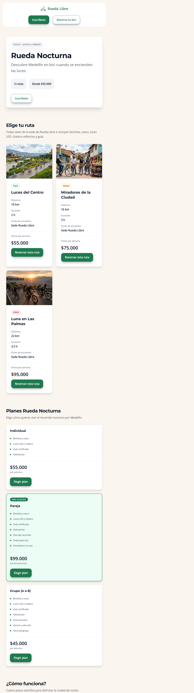
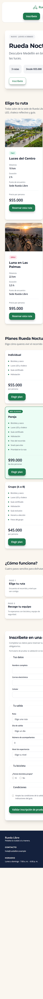
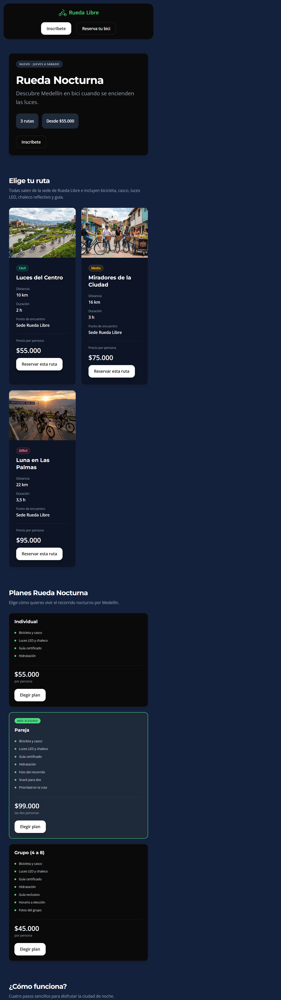

# Rueda Libre v2.0 + Rueda Nocturna

Sitio multipágina para conocer Rueda Libre, consultar rutas y tarifas y validar una reserva de bicicleta. La campaña **Rueda Nocturna** es una landing responsive construida con Tailwind CSS e integrada con el sitio principal hecho en Bootstrap.

## Enlaces publicados

- [Sitio Rueda Libre v2.0](https://dress18.github.io/rueda-libre/)
- [Landing Rueda Nocturna](https://dress18.github.io/rueda-libre/nocturna/)

## Páginas

| Página | Archivo |
| --- | --- |
| Inicio y carrusel con enlace a la campaña | [`index.html`](./index.html) |
| Tarifas y rutas | [`paginas/tarifas.html`](./paginas/tarifas.html) |
| Reserva de bicicleta | [`paginas/reservas.html`](./paginas/reservas.html) |
| Rutas, planes e inscripción Rueda Nocturna | [`nocturna/index.html`](./nocturna/index.html) |
| Kit de componentes Tailwind | [`nocturna/componentes.html`](./nocturna/componentes.html) |

El logo de la landing regresa al inicio del sitio y el botón «Reserva tu bici» abre la página de reservas. Las rutas relativas están preparadas para funcionar desde la raíz del repositorio y desde GitHub Pages.

## Tecnologías

- Bootstrap 5.3.8, Bootstrap Icons, CSS propio con variables de marca y JavaScript para la navegación, el carrusel y el modal.
- Tailwind CSS 4.3.4 desde CLI, tema personalizado con `@theme`, variantes `dark:` y componentes reutilizables con `@layer components` y `@apply`.
- HTML semántico y validación nativa de formularios.

Para revisar localmente, sirve la raíz del repositorio con Live Server u otro servidor estático; así se conservan las rutas entre `index.html` y `nocturna/`. Para regenerar la hoja minificada, desde `nocturna/`:

```powershell
npm exec -- tailwindcss -i ./src/input.css -o ./src/output.css --minify
```

## Bootstrap vs. Tailwind — MiniReto 8

Mediciones realizadas en las versiones de este proyecto. Los tamaños transferidos de Bootstrap se leyeron en DevTools, pestaña **Network**; el CSS de Tailwind se midió en `src/output.css`, generado con `--minify`.

| Criterio | Bootstrap 5.3.8 — sitio v2.0 | Tailwind CSS 4.3.4 — landing |
| --- | --- | --- |
| Curva de aprendizaje | Más rápida al iniciar: navbar, carrusel, modal y botones tienen patrones listos. | Requiere aprender y combinar utilidades; el kit de componentes ayuda a mantenerlas consistentes. |
| Personalización | La marca se conecta mediante variables `--bs-*` y estilos propios, partiendo de componentes predefinidos. | `@theme`, utilidades y `dark:` permiten ajustar directamente colores, estados, responsive y tema nocturno. |
| Tamaño medido | CSS base: **232.111 B** descomprimidos (**33.348 B** transferidos). Bundle JS: **80.496 B** descomprimidos (**24.769 B** transferidos). | CSS minificado: **30.522 B**. La hoja se sirve localmente sin compresión; no incluye JavaScript de Tailwind. |
| Casos de uso | Conveniente para sitios multipágina que necesitan componentes e interacciones estándar con rapidez. | Conveniente para interfaces responsive muy personalizadas, con identidad visual y temas propios. |

En esta comparación, la hoja final de Tailwind es aproximadamente **86,9 % menor** que el CSS base descomprimido de Bootstrap. No son páginas equivalentes en funcionalidad: la landing no replica el carrusel ni el menú colapsable del sitio, y el CSS de Bootstrap Icons y los estilos propios no están incluidos en esa medición.

**Recomendación para Rueda Libre:** usar Tailwind para campañas como Rueda Nocturna, donde la personalización visual, el responsive y el modo oscuro son centrales. Mantener Bootstrap en el sitio v2.0 por sus interacciones ya construidas; una migración completa solo conviene después de reconstruir y volver a medir esas funciones.

## Capturas







## Validación y estado de entrega

- Las cuatro páginas locales —inicio, tarifas, reservas y landing— pasaron el validador W3C Nu con **0 errores y 0 advertencias**.
- A 360, 768 y 1280 px, las cuatro páginas locales no presentan desbordamiento horizontal. La landing cambia de fondo entre claro y oscuro según la preferencia del sistema.
- El formulario de campaña bloquea campos vacíos e inválidos y muestra el estado de prueba al completarse; no envía ni guarda información. El formulario de reservas supera sus reglas de validez con datos de prueba, pero no se envió porque el proyecto no tiene backend configurado.
- Se agregó el favicon SVG de la marca a las páginas y la revisión local de los ocho HTML no registró errores HTTP. No se encontraron bloques `<style>` ni atributos `style=`. `nocturna/src/output.css` está minificado y su versión publicada responde HTTP 200.
- Las páginas públicas consultadas responden HTTP 200. **Publicación pendiente:** no se hizo commit ni push. GitHub Pages todavía sirve el HTML anterior a las correcciones locales; el W3C remoto reportó un error antiguo por página en Inicio, Reservas y la landing. El nuevo `img/favicon.svg` tampoco está publicado y responde 404 en la versión actual. Después de publicar estos archivos, vuelve a validar las URLs y el favicon.

La bitácora detallada de ejercicios, tiempos y comprobaciones está en [`bitacora.md`](./bitacora.md).

## Guion de demo — máximo 3 minutos

1. **0:00–0:25 — Contexto:** explicar que el sitio principal y la campaña estaban separados y que la meta fue enlazarlos.
2. **0:25–1:05 — Recorrido:** desde Inicio, abrir Rueda Nocturna; mostrar las tres rutas, los planes y «Más elegido».
3. **1:05–1:45 — Inscripción:** llegar al formulario, mostrar las etiquetas y grupos, y cómo la validación bloquea datos incorrectos.
4. **1:45–2:20 — Responsive y tema:** emular 360 px y activar la preferencia de color oscuro.
5. **2:20–3:00 — Decisiones técnicas:** explicar la continuidad de Bootstrap en v2.0 y Tailwind para la personalización de la campaña, usando las mediciones de CSS y JavaScript anteriores.

## Aprendizajes

- Las rutas relativas permiten integrar dos productos y publicarlos bajo el mismo repositorio sin duplicar la marca.
- Un kit pequeño de componentes y el orden de utilidades hacen más legible Tailwind sin convertir cada card en una clase compuesta.
- Los tamaños de recursos y las pruebas responsive sirven para comparar implementaciones, siempre indicando qué recursos y funciones quedan fuera de la medición.
- Una demo verificable requiere mostrar también límites reales: formularios sin backend y cambios locales aún no publicados.

## Autoría

**Autor:** Andrez18.
